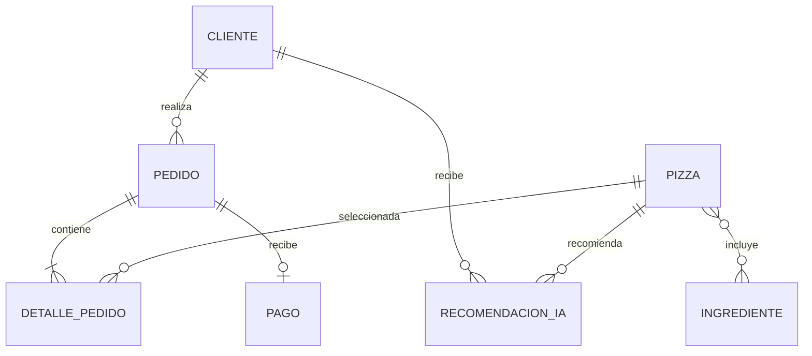

# Modelo de datos PizIA

## Entidades

| Entidad | Datos principales | Relaciones |
|---|---|---|
| Cliente | id, nombre, email | Tiene pedidos y recomendaciones. |
| Ingrediente | id, nombre | Puede integrar varias pizzas. |
| Pizza | id, nombre, tamano, precio | Cada combinación de receta y tamaño tiene un precio e ingredientes. |
| Pedido | id, fecha, estado | Pertenece a un cliente y contiene uno o mas detalles. |
| DetallePedido | pedido, pizza, cantidad, precio_unitario | Relaciona el pedido con una pizza y conserva su precio al comprar. |
| Pago | id, monto, metodo, fecha_pago | Un pago por pedido. |
| RecomendacionIA | id, motivo, fecha | Pertenece a un cliente y referencia una pizza. |

## Reglas vigentes

- El correo del cliente es unico.
- El precio de la pizza y el monto del pago son decimales con dos posiciones.
- El estado del pedido es recibido, en preparacion, listo, entregado o cancelado.
- Cada pedido admite un solo pago.
- Un pedido puede contener varias pizzas mediante `DetallePedido`; cada detalle guarda cantidad y precio unitario historico.
- Los tamaños disponibles son pequeña, porción, mediana y grande; la migración `0007_cargar_menu_pizzas` carga las diez recetas del menú.
- El campo `Pedido.pizza` se conserva temporalmente por compatibilidad y apunta a la primera pizza del pedido.
- El formulario y la API de pago validan que el monto coincida con la suma de los detalles.
- El recomendador compara ingredientes de compras previas y popularidad; no usa un modelo generativo.

## Evolucion recomendada

La migracion `0005_detallepedido_multi_pizza` agrega los detalles y convierte automaticamente los pedidos anteriores. El campo legado `Pedido.pizza` puede retirarse mas adelante, cuando se confirme que no hay integraciones antiguas.
